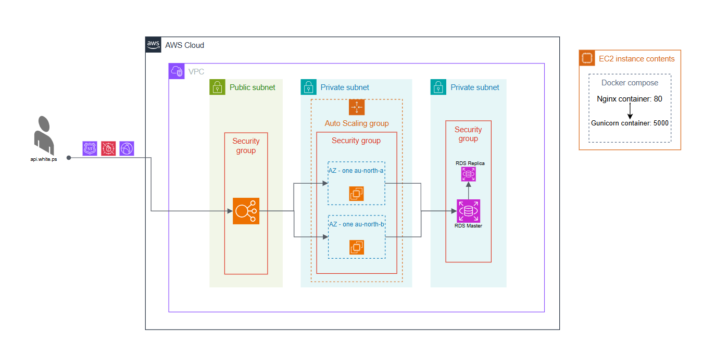

 

# Three-Tier AWS Infrastructure

### An end-to-end, production-style cloud infrastructure, designed, deployed, and automated on AWS

## 📖 About

This project demonstrates the design and implementation of a production-style three-tier infrastructure on **Amazon Web Services (AWS)**.

The goal was to build a scalable, highly available, and automated cloud environment while understanding the complete infrastructure lifecycle — from network architecture and infrastructure provisioning to configuration management, CI/CD, and observability.

The project combines multiple DevOps and cloud engineering tools to manage infrastructure in a structured and repeatable way.

## 🏗️ Architecture

The infrastructure is deployed across multiple Availability Zones, separating the application and database layers into private networks while exposing the application through a public Application Load Balancer.

## 🧩 Infrastructure Components

### 01 · Infrastructure as Code

**Terraform**

Provisioning and managing AWS resources through reusable infrastructure code, including VPC networking, subnets, route tables, security groups, Application Load Balancer, EC2 Auto Scaling, and Amazon RDS.

### 02 · Image Building

**Packer**

Building custom Amazon Machine Images (AMIs) to provide consistent and repeatable EC2 instance configurations.

### 03 · Configuration Management

**Ansible**

Automating server configuration, software installation, application setup, and environment preparation across EC2 instances.

### 04 · CI/CD Automation

**GitHub Actions**

Automating infrastructure workflows and deployment tasks, integrating Terraform, Packer, and Ansible into a repeatable delivery pipeline.

### 05 · Observability & Monitoring

**Amazon CloudWatch**

Monitoring infrastructure performance, collecting logs and metrics, configuring alarms, and providing visibility into the health and behavior of AWS resources.

## 🛠️ Technology Stack

  

- **Cloud Provider:** AWS
- **Infrastructure as Code:** Terraform
- **Image Building:** Packer
- **Configuration Management:** Ansible
- **CI/CD:** GitHub Actions
- **Monitoring & Observability:** Amazon CloudWatch

---

**Built as a hands-on journey into production-style cloud infrastructure and DevOps engineering.**

